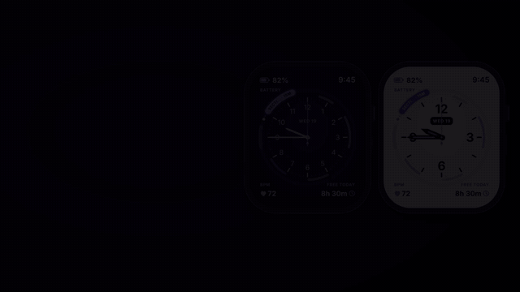
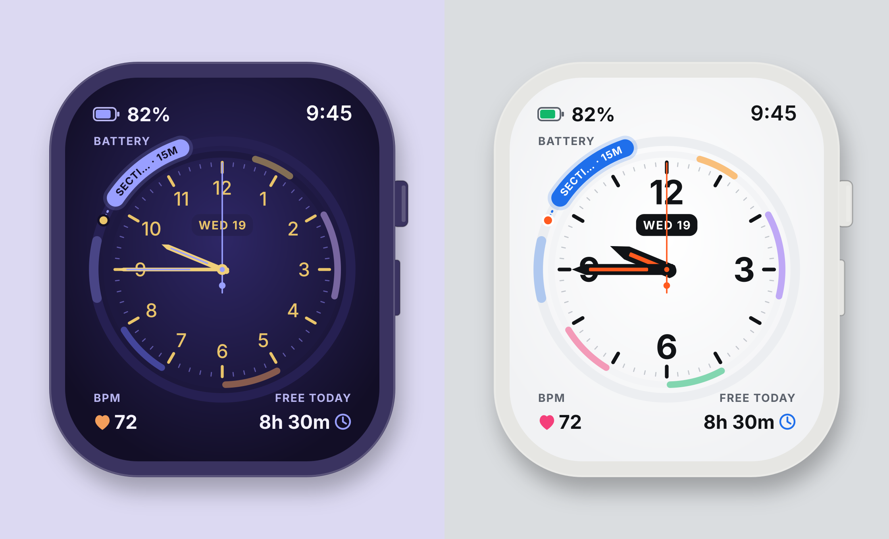
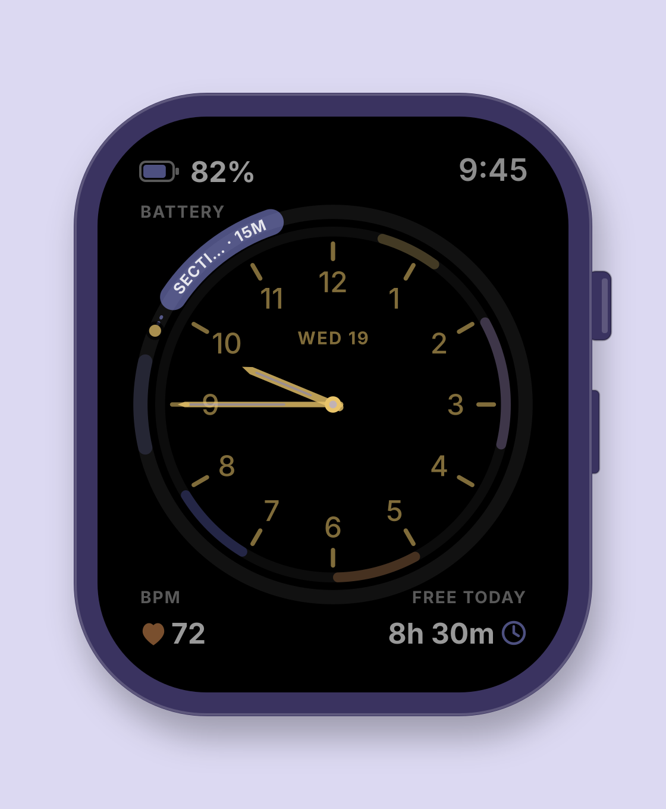
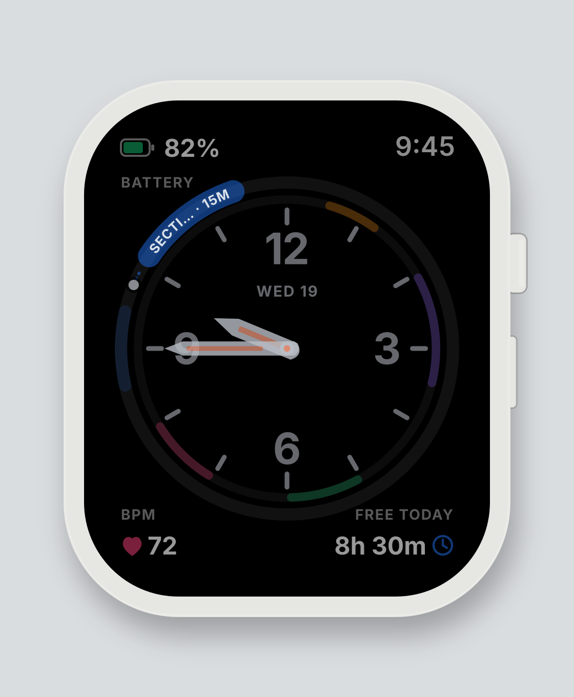

# AnalogCal

A watchOS app that shows today's calendar events as arcs around an analog dial.

[Watch the demo in full quality (MP4)](design/demo/analogcal-demo.mp4). It is animated from the app's design, not recorded from a watch.

## Features

- **Two faces:** Amethyst (purple and gold) and Chalk (white). Long-press the dial for Settings to switch.
- **Your day around the dial:** morning events on the outer ring, afternoon on the inner; finished events fade.
- **Next event on its arc:** the arc is thickened and labelled with the event's name and a countdown.
- **Digital Crown:** each click moves the label to the next or previous event; it returns to what's next after a few seconds.
- **Double tap:** pinch your index finger and thumb (Series 9, Ultra 2 and later) to open the highlighted event.
- **Reminders:** a haptic notification 5–30 minutes before each event, set in Settings.
- **Always On:** with your wrist down the face turns black and dims to save battery.
- **Date window:** moves from 12 to 6 o'clock when the hands would cover it.
- **Corners:** battery, heart rate and free time left today. The top-right is left for watchOS's own clock.
- **Complications:** *Up Next* (rectangular, with a countdown) and *Day Ring* (circular).

| Always On | |
|---|---|
|  |  |

## Setup

Events come from the watch's calendar. Google calendars sync in through the iPhone's Calendar app;
to include secondary or shared Google calendars, tick them at
[calendar.google.com/calendar/syncselect](https://calendar.google.com/calendar/syncselect).
Heart rate comes from Apple Health, with permission.

Built with Xcode 27 for watchOS 26.6 and later.

## Design files

`design/` holds the Amethyst and Chalk faces as SVG and PNG, and `design/tools/` the Python scripts
that draw them and render the demo (they need `rsvg-convert`, `ffmpeg`, Pillow and the Inter font).
